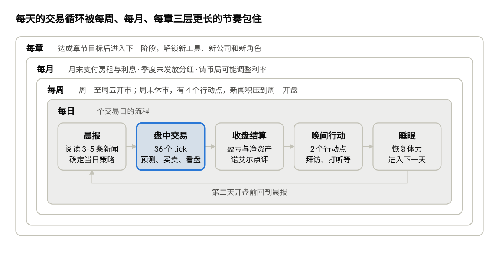
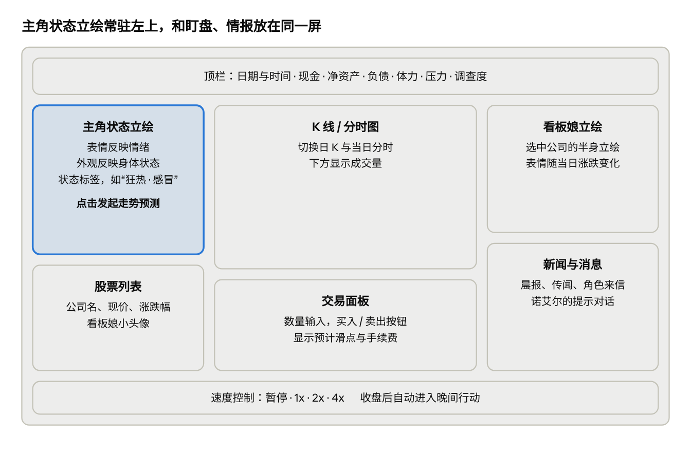
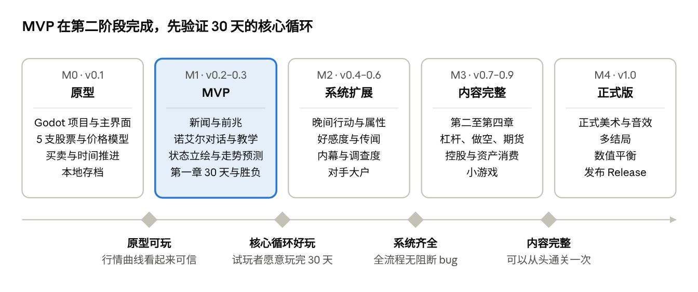

# Stock-Life 游戏设计文档

Oct 28, 2026 · @Yukimyau Tsukishiro

## 1. 项目概述

《Stock-Life》（工作名）是一款 2D 二次元风格的轻量 PC 股市模拟游戏：玩家在异世界金融帝国的首都，扮演一位背负债务的少女见习交易员，靠读新闻、交朋友、低买高卖，在经济腾飞与泡沫崩盘之间成为“帝国股神”。

| 项目           | 内容                                                           |
|----------------|----------------------------------------------------------------|
| 类型           | 股市模拟 + 生活模拟 + 轻度角色养成                             |
| 平台           | PC 桌面（Windows 优先，macOS / Linux 可选），使用 Godot 4 开发 |
| 画风           | 2D 二次元，半身立绘 + 表情差分                                 |
| 玩家           | 单人，离线可玩                                                 |
| 参考作品       | 《东京股神 STONKS-9800》（交易 + 生活事件 + 时代氛围）         |
| 发布与版本管理 | GitHub 仓库管理源码，GitHub Releases 发布可执行版本            |
| 一局时长       | MVP（第一章 30 天）约 30–45 分钟，待测试确认                   |

### 设计支柱

1.  **读信息，而不是掷骰子**：重大行情前都有可察觉的前兆，玩家赢了会觉得是自己看得准。

2.  **角色就是玩法**：主角的状态立绘直接展示她的心情和身体，看板娘的表情反映股价，角色关系决定情报质量。

3.  **有规律的随机**：事件大体按规律出现，但具体哪天发生在小范围内随机；主角的预测时准时不准，信不信由玩家自己决定。

4.  **轻量即玩**：用 Godot 导出为单个程序，解压即玩、离线运行，存档就在游戏旁边的 saves 文件夹里。

5.  **泡沫的戏剧性**：整局游戏跟随一个“繁荣 → 狂热 → 崩盘”的经济大周期，节奏有起伏、有高潮。

## 2. 世界观设定

故事发生在赫尔墨斯帝国的首都“奥鲁姆”。魔导革命刚过去十二年，魔晶石引擎、魔导列车和飞龙物流让帝国进入前所未有的经济上升期，而奥鲁姆皇家交易所正是这场繁荣的心脏。

### 时代背景

- **魔导革命**：魔晶石取代人力和畜力，工厂、铁路、浮空船快速扩张，新公司接连上市。

- **全民炒股热**：贵族、商人、冒险者、甚至酒馆侍女都在讨论股票，街头到处是“三天翻倍”的传说。

- **隐患**：魔晶石矿藏有限、贵族借钱炒股、地下钱庄放出大量高利贷，繁荣下面埋着崩盘的引线。

### 首都区域

| 区域       | 主要设施                           | 游戏中的作用             |
|------------|------------------------------------|--------------------------|
| 金穗大道   | 皇家交易所、帝国银行、各大商社总部 | 交易、拜访公司、银行借贷 |
| 魔导工业区 | 魔导工坊、魔晶石精炼厂             | 工业股相关事件、实地调查 |
| 港区       | 龙运码头、海商行会                 | 运输与贸易股事件         |
| 贵族区     | 沙龙、歌剧院、贵族议会             | 结识大户、提升名声       |
| 学院区     | 帝国魔导学院、图书馆               | 学习技能、技术突破类新闻 |
| 下城       | 酒馆、地行龙竞技场、黑市           | 传闻、小游戏、黑鸦商会   |

### 主要势力

- **帝国铸币局**：相当于央行，调整“金币利率”，是最重要的宏观事件来源。

- **贵族议会**：通过法案（新税、关税、管制令），影响整个行业。

- **冒险者公会**：魔物讨伐成败直接影响运输、矿业、药剂等行业。

- **圣光教会**：反对投机与高利贷，可能推动“投机管制令”。

- **黑鸦商会**：地下组织，提供高利贷和内幕消息，代价不菲。

- **金融监察厅**：调查操纵市场和内幕交易，对应玩家的“调查度”。

### 主线大周期

完整版跨越帝国历 3 年，分为四章，每章对应经济周期的一个阶段：

1.  **第一章 · 黎明**：繁荣初期，行情温和上涨，用来教学。

2.  **第二章 · 繁荣**：新公司大量上市，杠杆和做空解锁。

3.  **第三章 · 狂热**：泡沫高峰，涨幅惊人，风险信号开始出现。

4.  **第四章 · 崩盘**：魔晶石危机引爆连锁崩溃，考验玩家能否提前撤离或逆势做空。

## 3. 角色设定

角色分为三类：辅助玩家的伙伴、代表股票的看板娘、推动市场的对手和势力人物。每个重要角色都同时是**情报源**，好感度越高，给出的信息越准。

### 主角

- 主角是一位美少女交易员，玩家可自定义名字（默认名：希雅），秘书诺艾尔称她“老板”。

- 背景：乡下出身的见习交易员，继承了叔叔在皇家交易所的交易席位，同时继承了叔叔欠黑鸦商会的 50,000 金币债务。

- 第一章目标：30 天内还清债务，否则失去席位（MVP 的胜负条件）。

- 她的状态立绘出现在游戏的各个画面，表情和外观实时反映她的情绪与身体状态（见第 7、9 节）。

- 她能对股价走势做出预测，准确度取决于当时的状态，信不信由玩家决定（见第 6 节）。

### 核心伙伴与人物

| 角色         | 身份                     | 性格                 | 玩法作用                                   |
|--------------|--------------------------|----------------------|--------------------------------------------|
| 诺艾尔       | 精灵族会计师，主角的秘书 | 冷静、毒舌、外冷内热 | 新手教学、每日分析报告；好感越高，预测越准 |
| 米娅         | 《金穗日报》猫耳记者     | 活泼、八卦、爱抢独家 | 提前透露新闻和传闻，真假参半               |
| 维多利亚     | 格兰兹家族千金，基金经理 | 高傲、价值投资派     | 对手大户，大单会推动股价；可结盟或对抗     |
| 卡尔（疯狗） | 下城投机客，散户领袖     | 热血、追涨杀跌       | 带动散户情绪，制造短期暴涨暴跌             |
| 渡鸦夫人     | 黑鸦商会会长             | 优雅、危险           | 债主；提供高利贷和内幕，代价是调查度       |
| 赛琳         | 金融监察厅监察官         | 正直、固执           | 调查度达到阈值时登场，决定约谈、冻结或逮捕 |

### 上市公司与看板娘

每家公司都有一位拟人化看板娘，她的立绘表情跟随当日涨跌变化（详见第 9 节）。MVP 先实装前 5 家。

| 公司           | 行业       | 看板娘                 | 股性             | 主要影响因素               |
|----------------|------------|------------------------|------------------|----------------------------|
| 艾尔德魔导工坊 | 魔导机械   | 艾尔（元气工程师）     | 成长股，波动中等 | 技术突破、魔晶石价格       |
| 龙脊运输       | 飞龙物流   | 琳德（龙人少女）       | 周期股           | 贸易量、魔物潮             |
| 晨星药剂       | 炼金医药   | 塞拉（安静的炼金术士） | 防御股，波动低   | 疫病、讨伐战伤亡           |
| 金麦商社       | 农业粮食   | 小麦（乡下大姐）       | 防御股，高分红   | 天气、关税法案             |
| 冒险者公会联合 | 讨伐与委托 | 莉莉（新人冒险者）     | 高波动           | 讨伐成败、勇者传闻         |
| 水晶矿业       | 魔晶石开采 | 克丽丝（矿工头领）     | 资源股，波动高   | 矿脉发现与枯竭（崩盘伏笔） |
| 帝国皇家银行   | 金融       | 艾莉诺（端庄行长千金） | 蓝筹股，高分红   | 铸币局利率                 |
| 幻灯歌剧院     | 娱乐       | 露露（当红歌姬）       | 题材股，暴涨暴跌 | 演出、绯闻、新歌姬出道     |

## 4. 核心玩法循环

游戏由四层嵌套的循环组成：每天的交易与生活、每周的休市节奏、每月的账单与分红、每章的经济阶段。



核心玩法循环 · 4 层节奏，每日 5 个环节

玩家大部分注意力放在高亮的“盘中交易”上，其余环节负责提供情报、制造压力和推进剧情。MVP 只实现第一章的 30 天，因此“每章”这一层先只有一个目标：还清债务。

## 5. 市场模拟系统

股价由“基本面价值 + 市场情绪 + 随机波动 + 事件冲击 + 玩家影响”共同决定，目标是让行情可解读、可预判，但不可完全预测。

### 交易时间

- 每个交易日 9:00–15:00（游戏内时间），每 10 分钟一个 tick，一天 36 个 tick。

- 现实时间约 1 秒 / tick，可切换暂停、1x、2x、4x。

- 周末和帝国节日休市，休市期间的新闻在下一个开盘日集中反映（保留“周一开盘惊吓”）。

- 单日涨跌幅上限 ±15%（涨停 / 跌停），防止数值失控。

### 价格模型

每个 tick，股价按下式更新：

```math
P_{t+1} = P_t \times \left(1 + \mu_{\text{macro}} + \mu_{\text{sector}} + \kappa \cdot \frac{V_t - P_t}{P_t} + \sigma \varepsilon_t + S_t + I_t\right)
```

| 符号     | 含义           | 来源                                           |
|----------|----------------|------------------------------------------------|
| μ_macro  | 大盘趋势       | 章节阶段 + 铸币局利率                          |
| μ_sector | 行业趋势       | 行业事件，同行业股票共享，形成联动             |
| V_t      | 基本面价值     | 公司事件（财报、技术突破、丑闻）改变它         |
| κ        | 均值回归强度   | 让股价长期向价值靠拢；狂热期调低，泡沫因此形成 |
| σ ε_t    | 随机波动       | 每家公司固定的 σ，ε 取自种子随机数             |
| S_t      | 事件冲击       | 新闻当天的跳涨 / 跳跌，可分几天衰减            |
| I_t      | 玩家与大户影响 | 大单造成的价格冲击，见下文                     |

随机数使用固定种子（seed），同一种子必然生成同一局行情，方便调试和平衡测试。

### 玩家对市场的影响

- 每支股票有“流动性”数值。下单量占流动性的比例越大，成交均价越差（滑点），同时推动股价。

- 早期资金少，几乎没有影响；后期资金庞大时，玩家必须分批建仓、分批出货，这是后期的新策略问题。

- 对手大户（维多利亚、卡尔）按各自的策略下单，同样产生影响，玩家可以从对话和成交量中读出他们的动向。

### 交易规则

- 最小交易单位 10 股；手续费 0.3%，卖出时另收 0.1% 交易税（数值待平衡）。

- 分红：每季度末按持股发放，蓝筹和防御股分红较高。

- 持股超过 50% 即取得控股权，可参与该公司的经营决策（完整版内容）。

### 金融工具解锁顺序

每解锁一种工具，诺艾尔都会用一段剧情教学，避免新手被复杂规则吓跑。

| 解锁时机   | 工具         | 说明                                                  |
|------------|--------------|-------------------------------------------------------|
| 第一章     | 现货买卖     | 基础玩法                                              |
| 第二章     | 融资（杠杆） | 向帝国银行借钱买入，最高 2 倍；跌破维持率会被强制平仓 |
| 第二章后半 | 融券（做空） | 借股卖出，股价下跌时获利                              |
| 第三章     | 魔晶石期货   | 押注魔晶石价格，为崩盘章节埋下关键工具                |
| 待定       | 期权         | 视复杂度决定是否加入                                  |

## 6. 情报与新闻系统

情报是这款游戏的核心资源：所有重大行情都会提前留下线索，玩家的技巧体现在收集、辨别和使用这些线索上。

### 情报来源

| 来源             | 获取方式                  | 可信度                 | 代价              |
|------------------|---------------------------|------------------------|-------------------|
| 《金穗日报》晨报 | 每天开盘前自动推送 3–5 条 | 高，但已被市场部分消化 | 无                |
| 诺艾尔的分析报告 | 每日收盘后                | 随好感度提升           | 无                |
| 米娅的独家消息   | 晚间拜访                  | 中，真假参半           | 行动点、好感度    |
| 酒馆传闻         | 晚间去下城酒馆            | 低                     | 行动点、少量金币  |
| 盘面异动         | 观察成交量和价格          | 客观但需解读           | 注意力            |
| 内幕消息         | 渡鸦夫人等                | 非常高                 | 大量金币 + 调查度 |

### 事件结构

每个事件在数据文件中定义以下字段：

- **类型**：公司、行业、宏观（铸币局利率、议会法案）、世界（魔物潮、龙族迁徙、勇者归来）。

- **影响**：受影响的股票或行业、对基本面价值 V 的改变、当天冲击 S 的大小和衰减天数。

- **前兆**：事件发生前 1–5 天出现的线索，例如相关小新闻、角色台词、成交量放大。

- **真假**：传闻类事件有一定概率是假的，假传闻只造成短暂波动，随后回落。

### 事件时间：有规律，但不准时

事件大体按规律出现，但具体哪一天、哪个时刻发生，在一个小范围内完全随机：玩家能感觉到“快来了”，却说不准到底是哪天。

| 事件             | 大体规律             | 随机范围（初稿）               |
|------------------|----------------------|--------------------------------|
| 铸币局利率决议   | 约每 3 个月一次      | 预定日期前后 ±5 个交易日       |
| 公司季度财报     | 每季度一次           | 季末后第 5–15 个交易日         |
| 魔物潮           | 集中在春季和秋季     | 当季内任意一周                 |
| 议会法案表决     | 议会会期内           | 会期内随机，表决前先有辩论新闻 |
| 前兆到事件的间隔 | 先出前兆，再发生事件 | 1–5 天                         |

- **发生时刻也随机**：可能出现在开盘前的晨报、盘中某个 tick 的突发快讯，或休市日（下一个开盘日跳空）。

- **前兆不暴露日期**：前兆只说明事件临近，不给出确切时间。

- **实现方式**：开局时为每个事件生成“预定日期”，再在随机范围内抽取实际日期和时刻，存入事件日程表。

- **每局都不同**：新游戏默认使用新的随机种子，玩家无法背下事件日期；指定同一种子仍可复现整局，供调试和平衡测试。

### 内幕交易与调查度

- 使用内幕消息、操纵股价（短时间大量买卖同一支股票）会增加“调查度”（0–100）。

- 调查度随时间缓慢下降；名声高、与赛琳关系好时下降更快。

| 调查度 | 后果                          |
|--------|-------------------------------|
| 40     | 赛琳登场，进行约谈警告        |
| 70     | 部分账户被冻结 7 天，无法交易 |
| 100    | 被逮捕，进入“入狱”坏结局      |

### 主角的走势预测

主角可以预测一支股票接下来的走势，准确度由她当时的情绪和身体状态决定：结果可能与真实走势完全相同，也可能完全相反，是否采纳由玩家自己判断。

**使用方式**

- 在交易界面点击主角立绘发起预测，选择股票和时间跨度：今日剩余时段、明日、未来 3 天。

- 每天最多预测 3 次，每次消耗少量体力（次数和消耗待平衡）。

- 预测结果包括方向（涨 / 跌 / 横盘）、力度（小幅 / 大幅），以及她的一句台词和对应表情。

- 界面不显示准确率数字，玩家只能通过她的立绘和状态描述自己判断信不信。

**生成规则**

1.  引擎用当前随机种子向后推演“玩家不干预”的走势，得到真实方向和力度。

2.  根据主角状态计算本次预测的正确率 p。

3.  以概率 p 给出真实结果，否则给出相反方向；狂热时偏向说“大涨”，恐慌时偏向说“大跌”。

```math
p = \mathrm{clamp}\left(p_{\text{情绪}} + \Delta_{\text{身体}} + \Delta_{\text{经验}},\ 0.05,\ 0.95\right)
```

| 状态     | 类型 | 对正确率的影响（初稿） | 预测特点                               |
|----------|------|------------------------|----------------------------------------|
| 平静     | 情绪 | 基础 70%               | 最可靠                                 |
| 乐观     | 情绪 | 基础 60%               | 略偏向看涨                             |
| 悲观     | 情绪 | 基础 60%               | 略偏向看跌                             |
| 狂热     | 情绪 | 基础 35%               | 几乎总说“大涨”，经常和事实相反         |
| 恐慌     | 情绪 | 基础 35%               | 几乎总说“大跌”                         |
| 健康     | 身体 | ±0                     | 无                                     |
| 疲劳     | 身体 | −10%                   | 力度判断经常出错                       |
| 感冒     | 身体 | −15%                   | 每天只能预测 1 次                      |
| 发烧     | 身体 | 直接改为 50%           | 纯属随机，偶尔“神预言”，偶尔完全反着来 |
| 学院进修 | 经验 | 最多 +10%              | 长期成长                               |

正确率低于 50% 时反向操作也能获利，这是对读懂她状态的玩家的奖励；狂热和恐慌通常只持续 1–3 天，并随行情变化，难以稳定利用。

## 7. 生活模拟

白天盯盘、晚上经营生活：生活系统负责制造取舍，让“多赚一点”和“照顾好自己与身边的人”之间产生张力。

### 时间与行动点

- 工作日晚间有 2 个行动点，休市日有 4 个。

- 可选行动：拜访角色、去酒馆打听、实地考察公司、学院进修、休息、娱乐（小游戏）。

- 盯盘本身不消耗行动点，但会累积疲劳。

### 角色属性

| 属性   | 范围           | 上升原因             | 影响                                               |
|--------|----------------|----------------------|----------------------------------------------------|
| 体力   | 0–100          | 休息、住所等级       | 决定身体状态；降到 0 会住院 3 天，期间市场照常运行 |
| 压力   | 0–100          | 连续亏损、熬夜、负债 | 压力越高越容易进入悲观或恐慌                       |
| 名声   | 0–100          | 大额盈利、社交、慈善 | 解锁贵族沙龙、大客户和更低的借贷利率               |
| 好感度 | 每个角色 0–100 | 拜访、送礼、剧情选择 | 决定情报质量，解锁角色剧情与结局                   |

### 主角状态

主角同时处于一种情绪状态和一种身体状态，两者都直接显示在她的立绘上，并决定走势预测的准确度（见第 6 节）。状态每天收盘和睡眠后重新判定。

| 状态 | 类型 | 进入条件（初稿）                       | 其他影响                         |
|------|------|----------------------------------------|----------------------------------|
| 平静 | 情绪 | 默认；压力适中、盈亏平稳               | 无                               |
| 乐观 | 情绪 | 近 3 个交易日累计盈利                  | 晚间社交好感度加成               |
| 悲观 | 情绪 | 近 3 个交易日累计亏损                  | 压力上升更快                     |
| 狂热 | 情绪 | 连续大赚，或大盘处于狂热期             | 可能触发“全仓买入”冲动抉择       |
| 恐慌 | 情绪 | 单日大亏，或压力 ≥ 80                  | 可能触发“恐慌卖出”抉择           |
| 健康 | 身体 | 体力 ≥ 50                              | 无                               |
| 疲劳 | 身体 | 体力 \< 50                             | 晚间行动点 −1                    |
| 感冒 | 身体 | 随机事件（换季、淋雨），疲劳时概率更高 | 体力恢复减半                     |
| 发烧 | 身体 | 感冒期间没有休息而恶化                 | 晚间只能休息；继续工作有住院风险 |
| 住院 | 身体 | 体力降到 0                             | 3 天无法交易                     |

### 资产消费

消费不只是数字，每次升级都会带来看得见的变化和实际效果。

| 类别 | 升级路线                        | 效果                                       |
|------|---------------------------------|--------------------------------------------|
| 住所 | 阁楼 → 公寓 → 宅邸 → 浮空庄园   | 每晚恢复更多体力、降低压力，可邀请角色来访 |
| 交通 | 步行 → 马车 → 魔导车 → 私人飞龙 | 每晚多 1 个行动点（最高 +2）               |
| 服装 | 平民服 → 正装 → 贵族礼服        | 提升名声，解锁社交场合                     |

### 小游戏（MVP 之后）

- **地行龙竞速**：押注下城竞技场的比赛，替代赛马。

- **酒馆卡牌**：与卡尔等人打牌，赢了可以换到传闻。

- **魔晶石彩票**：低成本、低概率的轻松玩法。

小游戏只使用游戏内金币，不涉及任何真实付费。

## 8. 成长、解锁与结局

玩家的成长来自三条线：资金规模、可用的金融工具、角色关系。结局由崩盘章节结束时这三条线的状态共同决定。

### 章节目标

| 章节          | 时长（游戏内） | 通关目标                                 | 主要解锁                         |
|---------------|----------------|------------------------------------------|----------------------------------|
| 第一章 · 黎明 | 30 天          | 还清 50,000 金币债务                     | 现货交易、诺艾尔分析、5 家公司   |
| 第二章 · 繁荣 | 约 6 个月      | 净资产达到 500,000 金币                  | 杠杆、做空、新上市公司、贵族社交 |
| 第三章 · 狂热 | 约 12 个月     | 净资产达到 5,000,000 金币或控股 1 家公司 | 魔晶石期货、控股经营             |
| 第四章 · 崩盘 | 约 6 个月      | 度过崩盘，保住财富                       | 结局分支                         |

各章时长和目标金额为初稿，需在平衡测试后调整。

### 结局

| 结局     | 条件                                     | 类型                         |
|----------|------------------------------------------|------------------------------|
| 帝国股神 | 净资产第一，且在崩盘中成功撤离或做空获利 | 最佳结局                     |
| 财阀之主 | 崩盘结束时控股 3 家以上公司              | 好结局                       |
| 归隐田园 | 某位角色好感度满，主动退出市场           | 角色结局（每位主要角色一个） |
| 黑鸦之王 | 与黑鸦商会深度合作并取代渡鸦夫人         | 隐藏结局                     |
| 破产     | 现金和持仓归零且无法借款                 | 坏结局（任何时候可能触发）   |
| 入狱     | 调查度达到 100                           | 坏结局                       |
| 过劳     | 一年内住院 3 次                          | 坏结局                       |

多结局和角色线是重玩价值的主要来源；每局使用不同随机种子，行情走势也会不同。

## 9. 美术与音效方向

整体风格是“魔导蒸汽朋克 + 二次元”：金色与深蓝为主色，交易终端设计成镶嵌魔晶石的水晶屏，角色采用清爽的赛璐璐上色。

### 角色立绘

- 主要角色和看板娘使用半身立绘，每人 6 种表情差分。

- MVP 阶段使用剪影占位图或简单头像，等玩法验证后再投入正式美术。

### 主角状态立绘

主角的状态立绘是全游戏出现最多的美术资源，也是玩家判断她情绪和身体状态、决定是否相信她预测的主要依据。

- **出现位置**：交易主界面、晨报、日结算、晚间城市地图、角色对话、预测结果弹窗、结局画面。

- **分层制作**：底图（服装与姿势）+ 表情层（情绪）+ 叠加层（身体状态的道具和特效），减少需要绘制的组合数量。

- **组合显示**：情绪和身体状态同时显示，例如“狂热 + 感冒”是戴着口罩、眼睛却闪着金币光。

- **MVP 占位**：先用简单头像加文字标签表示状态，正式版再替换。

| 状态 | 立绘表现                       |
|------|--------------------------------|
| 平静 | 微笑，坐姿端正                 |
| 乐观 | 开朗笑容，比出 V 字手势        |
| 悲观 | 皱眉低头，叹气                 |
| 狂热 | 眼中闪金币光，脸颊泛红，握拳   |
| 恐慌 | 冒冷汗，抱头                   |
| 疲劳 | 黑眼圈，打哈欠                 |
| 感冒 | 戴口罩，鼻头发红，披着毯子     |
| 发烧 | 满脸通红，额头敷冰袋，眼神迷离 |
| 住院 | 病号服，躺在病床上             |

### 看板娘与其他角色

看板娘表情与当日涨跌幅的对应关系（阈值待调整）：

| 当日涨跌幅   | 表情               |
|--------------|--------------------|
| 涨停（+15%） | 狂喜，背景金色光效 |
| +3% 以上     | 开心               |
| −3% 到 +3%   | 普通               |
| −3% 以下     | 担忧               |
| −8% 以下     | 哭泣               |
| 跌停（−15%） | 崩溃，画面变灰     |

### 演出与反馈

- **开盘 / 收盘**：交易所钟声，伴随简短的开场和结算动画。

- **涨停**：金币粒子从屏幕上方落下，看板娘切换狂喜表情。

- **暴跌**：屏幕轻微震动，界面色调变灰。

- **连胜**：连续盈利的交易显示连击计数。

- **日结算**：展示当日盈亏、净资产变化和秘书的一句点评。

### 音效与音乐

- BGM 跟随大盘情绪切换：平稳、上涨、狂热、恐慌四种。

- 关键音效：开收盘钟声、成交音、涨停音、跌停音、金币音。

- 优先使用可商用的免费素材，并在仓库中记录每个素材的来源和许可。

## 10. UI 与界面

交易时段只用一个主界面：左边是主角状态立绘和股票列表、中间看图和下单、右边看看板娘和情报，玩家不用切换页面就能完成一天的交易。



交易日主界面线框图 · 桌面端

高亮的主角状态立绘常驻左上角，玩家一抬眼就能看到她的心情和身体状况，点击她即可发起走势预测；看板娘立绘放在右侧，反映所选股票的涨跌。

### 其他界面

| 界面       | 用途                                                                                    |
|------------|-----------------------------------------------------------------------------------------|
| 标题与存档 | 新游戏（可输入随机种子）、继续、存档槽列表（读取 saves 文件夹中的存档）、打开存档文件夹 |
| 预测弹窗   | 主角立绘 + 台词 + 预测方向与力度，玩家选择采纳或忽略                                    |
| 日结算     | 当日盈亏、净资产曲线、主角状态变化、秘书点评                                            |
| 城市地图   | 晚间选择去哪个区域、执行哪个行动；主角立绘显示在角落                                    |
| 角色对话   | 主角与对方的半身立绘 + 对话框 + 选项                                                    |
| 持仓与资产 | 持股、成本、浮动盈亏、住所与交通等级                                                    |

布局以 1280×720 为基准设计，使用 Godot 的 canvas_items 拉伸模式适配其他分辨率，支持窗口与全屏切换；手机适配列入待定事项。

## 11. 技术方案

使用 Godot 4 开发，脚本语言为 GDScript，导出为 Windows 桌面程序（macOS / Linux 可选）；源码在 GitHub 上做版本管理，可执行版本通过 GitHub Releases 发布。

### 为什么选择 Godot

- 桌面程序可以直接读写游戏旁边的 saves 文件夹，迁移存档只需复制文件。

- 免费开源（MIT 许可），2D 与 UI 功能完善，适合分层立绘、动画和粒子演出。

- 场景和脚本都是文本文件（.tscn、.gd），适合用 Git 做版本管理和对比差异。

### 技术选型

| 部分     | 选择                                                 | 理由                                    |
|----------|------------------------------------------------------|-----------------------------------------|
| 引擎     | Godot 4 最新稳定版，开工时确定具体版本并写进 README  | 所有人使用同一版本，避免项目文件不兼容  |
| 语言     | GDScript                                             | 语法接近 Python，上手快，与引擎集成最好 |
| 全局状态 | Autoload 单例：GameState、SaveManager、EventBus      | 任何场景都能访问状态、收发信号          |
| 图表     | 自定义 Control 节点，在 \_draw() 中绘制 K 线和分时图 | 无外部依赖，画风完全可控                |
| 立绘     | 多个 TextureRect 叠放：底图 + 表情层 + 状态叠加层    | 直接对应第 9 节的分层立绘方案           |
| 演出     | Tween、AnimationPlayer、CPUParticles2D               | 涨停金币、暴跌震屏、结算动画            |
| 数据     | JSON 文件（公司、角色、事件、对话）                  | 内容与代码分离，加剧情不用改代码        |
| 随机数   | RandomNumberGenerator，设置固定 seed                 | 行情可复现，便于调试和平衡测试          |
| 存档     | saves 文件夹中的 JSON 文件                           | 一个存档一个文件，复制即可迁移          |

### 项目结构

scripts/core 中的游戏逻辑不依赖任何场景节点，界面脚本只读取状态并显示，这样价格模型可以在无界面模式下单独测试。

```text
stock-life/
├── project.godot
├── scenes/
│ ├── title.tscn # 标题与存档槽
│ ├── main.tscn # 交易主界面
│ ├── city_map.tscn # 晚间城市地图
│ ├── dialog.tscn # 角色对话
│ └── ui/ # 图表、立绘、交易面板等可复用组件
├── scripts/
│ ├── autoload/
│ │ ├── game_state.gd # 游戏状态
│ │ ├── save_manager.gd # 存档读写、校验、版本迁移
│ │ └── event_bus.gd # 全局信号
│ ├── core/ # 纯逻辑，不依赖场景节点
│ │ ├── market.gd # 价格模型、撮合、滑点
│ │ ├── events.gd # 新闻、传闻、前兆，事件时间窗口调度
│ │ ├── calendar.gd # 日历、tick、休市
│ │ ├── life.gd # 体力、压力、情绪与身体状态、行动点、好感
│ │ └── predict.gd # 主角走势预测
│ └── ui/
│ ├── heroine_portrait.gd # 主角分层立绘与预测弹窗
│ ├── stock_board.gd # 股票列表与看板娘
│ ├── candle_chart.gd # K 线绘制
│ └── trade_panel.gd # 交易面板
├── data/
│ ├── companies.json
│ ├── characters.json
│ ├── events.json
│ └── dialogues/
├── assets/
│ ├── portraits/
│ ├── ui/
│ └── audio/
├── saves/ # 编辑器中运行时的存档，不提交到 Git
│ └── .gitkeep
├── tools/
│ └── simulate.gd # 无界面批量跑行情，用于平衡测试
├── docs/
│ └── GDD.md # 本设计文档的 Markdown 版
├── export_presets.cfg
├── .gitignore
├── README.md
└── LICENSE
```

### 核心状态（示意）

```json
{
  "seed": 20261028,
  "day": 1,
  "tick": 0,
  "cash": 10000,
  "debt": 50000,
  "holdings": {
    "elder": {
      "qty": 100,
      "avgCost": 12.5
    }
  },
  "stocks": {
    "elder": {
      "price": 12.8,
      "value": 13.0,
      "history": []
    }
  },
  "player": {
    "hp": 100,
    "stress": 20,
    "fame": 0,
    "heat": 0,
    "mood": "calm",
    "body": "healthy",
    "predictionsLeft": 3
  },
  "schedule": [
    {
      "event": "rate_decision_q1",
      "day": 63,
      "tick": 0
    }
  ],
  "affection": {
    "noelle": 10,
    "mia": 0
  },
  "flags": {}
}
```

### 存档系统

每个存档都是 saves 文件夹里的一个独立文件；把这个文件复制到另一台电脑的 saves 文件夹，就能在那里继续游戏。

SaveManager 根据运行方式决定 saves 文件夹的位置：

| 运行方式                      | saves 文件夹位置                                  |
|-------------------------------|---------------------------------------------------|
| 导出的游戏（Windows / Linux） | 可执行文件所在目录下的 saves/                     |
| 在 Godot 编辑器中运行         | 项目根目录下的 saves/                             |
| macOS 导出版                  | 用户数据目录 user://saves（应用包内部不适合写入） |
| 游戏目录没有写入权限时        | 自动改用 user://saves，并在设置界面显示实际路径   |

```gdscript
func get_save_dir() -> String:
	var dir: String
	if OS.has_feature("editor"):
		dir = ProjectSettings.globalize_path("res://saves")
	elif OS.get_name() == "macOS":
		dir = ProjectSettings.globalize_path("user://saves")
	else:
		dir = OS.get_executable_path().get_base_dir().path_join("saves")
	DirAccess.make_dir_recursive_absolute(dir)
	return dir
```

- **文件命名**：\<存档名\>.stocklife.json，如 slot1.stocklife.json；每天收盘后自动覆盖写入 autosave.stocklife.json。

- **安全写入**：先写到临时文件，写入成功后再重命名覆盖旧存档，避免写到一半崩溃导致存档损坏。

- **用 JSON，不用 Godot 的 Resource 格式**：.tres / .res 文件加载时可能执行其中嵌入的脚本，玩家之间分享存档会带来安全风险；JSON 只是数据。

- **校验**：读档时检查 format 字段和必要数据，文件损坏或不是本游戏存档时给出提示，而不是让游戏崩溃。

- **版本迁移**：存档带有 saveVersion，游戏更新后由 save_manager.gd 按版本号逐级升级旧存档。

- **打开存档文件夹**：标题界面提供按钮，用 OS.shell_open() 直接打开 saves 文件夹，方便玩家复制和备份。

存档文件结构（示意）：

```json
{
  "format": "stock-life-save",
  "saveVersion": 1,
  "gameVersion": "0.2.0",
  "savedAt": "2026-10-29T20:15:00+08:00",
  "label": "第一章 · 第 12 天",
  "data": {
    "seed": 20261028,
    "day": 12,
    "cash": 31800,
    "debt": 50000
  }
}
```

data 中保存上面“核心状态”的完整内容，这里只列出一部分。

### 运行、测试与导出

- **运行**：用 Godot 编辑器打开 project.godot 即可运行，不需要本地服务器。

- **平衡测试**：tools/simulate.gd 继承 SceneTree，用 godot --headless --script res://tools/simulate.gd 在无界面模式下批量跑上千局行情并输出统计。

- **导出**：在“项目 → 导出”中添加 Windows Desktop 预设（需先安装同版本的导出模板），导出为单个 .exe；发布的压缩包里附带一个空的 saves 文件夹。

- export_presets.cfg 提交到仓库，导出产物放在 build/ 中，不提交。

### GitHub 版本管理约定

- main 分支：始终能在编辑器中正常运行。

- dev 分支：日常开发，功能完成后合并到 main。

- 每个里程碑打一个版本标签，如 v0.1.0，并在 GitHub Releases 上传导出的 Windows 压缩包。

- 用 GitHub Issues 记录功能和 bug，用 Milestones 对应第 12 节的开发阶段。

- .gitignore 忽略 .godot/（编辑器缓存）、build/ 和 saves/ 中的存档文件，只保留 saves/.gitkeep。

- 立绘、音频等大文件较多时，可考虑使用 Git LFS。

- 本设计文档导出为 Markdown，放在 docs/GDD.md 一起做版本管理。

## 12. 开发里程碑

开发分为 5 个阶段，每个阶段对应一个 GitHub Milestone 和版本号；过门槛后才进入下一阶段。具体日期尚未确定。



开发路线图 · 5 个阶段，4 个门槛

高亮的 M1 是第一个对外发布的可玩版本。如果 M1 的试玩反馈说明 30 天循环不好玩，应先回头调整价格模型和情报节奏，而不是继续堆系统。

### MVP 范围（M0 + M1）

- [ ] 种子随机数与价格模型（5 家公司）

- [ ] 交易日时间推进：开盘、tick、收盘、周末休市

- [ ] 买入 / 卖出、手续费、持仓与净资产

- [ ] K 线与分时图

- [ ] 晨报新闻、事件前兆与随机时间窗口

- [ ] 主角情绪与身体状态（占位立绘 + 状态标签）

- [ ] 主角走势预测与预测弹窗

- [ ] 诺艾尔的教学与每日点评

- [ ] 看板娘表情切换（占位图）

- [ ] 第一章：30 天内还清 50,000 金币，成功 / 失败画面

- [ ] saves 文件夹存档：读写、校验、自动存档

- [ ] 导出 Windows 版本并发布到 GitHub Releases

## 13. 风险与待定事项

最大的风险是数值平衡和美术成本，其次是范围膨胀；应对原则是先用占位素材把核心循环做好玩，再加内容。

### 风险

| 风险         | 表现                                     | 应对                                                                       |
|--------------|------------------------------------------|----------------------------------------------------------------------------|
| 数值失衡     | 无脑长期持有就能赢，或结果全靠运气       | 用 tools/simulate.gd 批量跑上千局，统计不同策略的收益分布                  |
| 预测功能失衡 | 玩家完全依赖预测，或觉得它没用而完全忽略 | 模拟测试“只听预测”“反着听”“不听”三种策略，确保都赢不了会读状态的玩家       |
| 随机性太强   | 事件时间随机让玩家觉得被系统耍了         | 随机范围保持小，并始终保留前兆，让玩家输了也能找到原因                     |
| 美术成本高   | 主角状态立绘组合多，进度被美术卡住       | 主角立绘分层制作；MVP 只用占位图；正式版控制在 5–8 个主要角色              |
| 范围膨胀     | 想加的系统太多，迟迟做不出可玩版本       | 严格按里程碑推进，新点子先记入 Issues                                      |
| 存档丢失     | 存档文件被误删，或游戏目录没有写入权限   | 存档是独立文件，玩家可自行备份；目录不可写时自动改用用户数据目录并提示路径 |
| 赌博相关内容 | 小游戏和投机题材可能引起误解             | 只用游戏内货币，无任何真实付费，游戏内注明纯属虚构                         |
| 素材版权     | 使用来源不明的图片或音乐                 | 只用自制或明确可用的素材，在仓库记录来源与许可                             |
| 引擎学习成本 | 第一次使用 Godot，前期进度慢             | 先用 M0 原型熟悉引擎，跟着官方入门教程做一遍 2D 和 UI 示例                 |

### 待定事项

- [ ] 游戏正式名称（目前使用工作名 Stock-Life）

- [ ] 开源许可：代码是否用 MIT，美术素材是否单独授权

- [ ] 是否同时导出 macOS / Linux 版本，以及是否适配手机

- [ ] 正式美术的来源：自己绘制、约稿还是开源素材

- [ ] 是否提供中英双语

- [ ] 期权是否加入完整版
